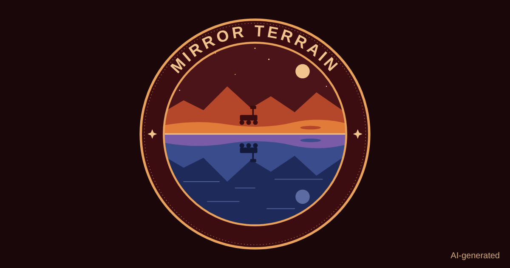

# Mirror Terrain

**Earth analogs for Moon south-pole sites and Mars rover landing sites, with new candidates in Türkiye.**

NASA Space Apps Challenge 2026, Istanbul local event.
Challenge: *Identify Earth Locations that Analog the Permanent Moon Base Locations and Mars.*

**Website:** https://talyamorgul.github.io/mirror-terrain/ (Türkçe · English · Français · Русский · Deutsch)

## What it does

Landers, rovers and base equipment bound for the Moon and Mars are first tested on Earth, on terrain that resembles the target. Mirror Terrain makes that choice measurable. It:

1. compares each target with Earth terrain **at the target's own resolution** (40 m for the Moon, 200 m and 463 m for Mars);
2. **validates** itself by checking whether it ranks known analog sites above vegetated control sites;
3. proposes **twin teams**: several Earth sites that together cover what one site cannot;
4. suggests **when** to test, from monthly climate data;
5. **scans all of Türkiye** in 0.1° cells and finds candidates that had not been described before;
6. lets you drive a **rover simulation** on the target and its Earth twins and compare the results.
7. turns the results into a **test campaign plan** for a chosen target and test purpose, which can be saved as a PDF;
8. lists what to measure in a **field check** at three Türkiye candidates, and which map value each measurement checks;
9. scores NASA's **nine Artemis candidate landing regions** near the lunar south pole with the same method;
10. lets you **click any cell on the Türkiye map** and compare it with every target.

## Targets

| Body | Targets | Elevation data |
|---|---|---|
| Moon | Shackleton crater, de Gerlache crater, Malapert massif | NASA LRO LOLA, 40 m |
| Mars | Gusev (Spirit), Jezero (Perseverance), Gale (Curiosity), Meridiani Planum (Opportunity) | MOLA + HRSC 200 m and MOLA 463 m |

## Method in short

- Every Earth site and target is cut into 12 km windows. Each window gets six terrain features: relief, mean slope, steep-slope slope (p90), share steeper than 15°, roughness and hypsometry.
- The share of barren ground (ESA WorldCover) is added, because a vegetated landscape is not an analog however its shape looks.
- Features are scaled against a fixed reference group, weighted, and turned into a 0–100 similarity score.
- Four test purposes (landing, rover, base, drilling) change the weights. Drilling also compares rock families (Macrostrat, USGS geologic maps of Mars and the Moon).
- Extra layers, not used in the score: climate and best test month (NASA POWER), soil (SoilGrids), permafrost, nearest airport, NASA EMIT minerals.

All details, limitations and sources are on the website under **Method & data** and **Validation**.

## Validation (from `docs/csv/validation.csv`)

| Data | Layers | AUC range across targets |
|---|---|---|
| Moon, LOLA 40 m | terrain + barren ground | 0.85–0.86 |
| Moon, LOLA 40 m | terrain only | 0.75–0.78 |
| Mars, HRSC + MOLA 200 m | terrain + barren ground | 0.64–0.68 |
| Mars, HRSC + MOLA 200 m | terrain only | 0.23–0.55 |

AUC measures how well known analogs are ranked above vegetated controls (0.5 = chance). On Mars, terrain shape alone is not enough at these resolutions; we report this rather than hide it.

## Repository

| Path | Contents |
|---|---|
| `docs/` | The website (static HTML + JavaScript, served with GitHub Pages) |
| `docs/data/` | JSON data the website reads, including elevation grids for the rover simulation |
| `docs/csv/` | All result tables as CSV |
| `docs/img/` | Figures and comparison cards |
| `notebook/MirrorTerrain.ipynb` | The Google Colab notebook that produces every result file |

## Reproduce

1. Open `notebook/MirrorTerrain.ipynb` in Google Colab.
2. Get a free OpenTopography API key and a free NASA Earthdata account, and add them in Colab Secrets as `OPENTOPO_KEY`, `EARTHDATA_USERNAME` and `EARTHDATA_PASSWORD`.
3. Run all cells. Results are saved to Google Drive (`MyDrive/MirrorTerrain`) and the last cell downloads them as a zip file.
   The clickable Türkiye cells need about 95 extra OpenTopography downloads. The free key allows 50 per 24 hours, so this section may need a second run the next day; it continues where it stopped.
4. To view the website locally, run `python -m http.server` inside `docs/` and open `http://localhost:8000`.

## Data sources

| Data | Provider | Terms |
|---|---|---|
| LRO LOLA south-pole DEM, 40 m | NASA | NASA |
| Mars HRSC + MOLA blended DEM, 200 m | NASA, ESA/DLR, USGS | NASA, ESA/DLR, USGS |
| Mars MOLA DEM, 463 m | NASA, USGS | NASA, USGS |
| NASADEM and Copernicus GLO-30 (via OpenTopography) | NASA, ESA/Copernicus | NASA, ESA/Copernicus |
| ESA WorldCover 2021, 10 m | ESA | © ESA WorldCover project, CC BY 4.0 |
| Sentinel-2 L2A (AWS Open Data) | ESA/Copernicus | Contains modified Copernicus Sentinel data |
| NASA POWER climatology | NASA | NASA |
| EMIT L2B mineral identification (LP DAAC) | NASA | NASA |
| Macrostrat geologic map API | Macrostrat | CC BY 4.0 |
| Artemis candidate landing region boundaries (ScienceBase item 671a6fa8d34efed5620f89f8) | USGS | USGS |
| Geologic Map of Mars, SIM 3292 (Tanaka et al. 2014) | USGS | USGS |
| Unified Geologic Map of the Moon, 1:5M (2020) | USGS | USGS |
| SoilGrids 2.0 | ISRIC | CC BY 4.0 |
| Northern Hemisphere permafrost zonation (Obu et al. 2019) | AWI / PANGAEA | CC BY 3.0 |
| OurAirports | OurAirports | Public domain |
| Natural Earth | Natural Earth | Public domain |

Map imagery on the website © Esri and partners; street map © OpenStreetMap contributors. Built with Leaflet and Chart.js. The sources for each study site and for the rover values are linked on the website.

## Use of artificial intelligence

- AI was used to create the logo and the video.
- Because of time constraints, AI carried out the literature reviews of the sources I selected and found.
- AI was used in developing the code.
- The French, German and Russian translations were made with AI.

Tool: Claude (Anthropic).

## Team

Talya Morgül — team owner and lead.

## License

© 2026 Talya Morgül. Licensed under [Creative Commons Attribution 4.0 International (CC BY 4.0)](https://creativecommons.org/licenses/by/4.0/). Third-party data keep their own licenses, listed above.
